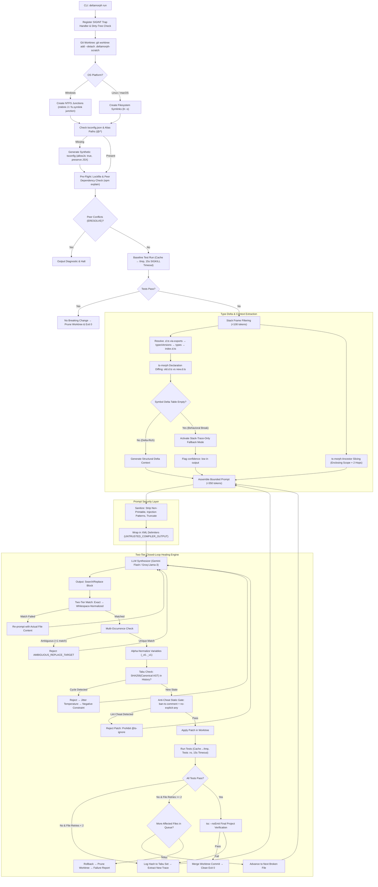

# System Architecture & Design Document (Version 2.3)
## System Name: DeltaMorph (Compiler-Verified Breaking-Change Healer)

**Lead Architect:** Uday Sharma ([@udaysharmadev](https://github.com/udaysharmadev))  
**Academic Affiliation:** Dawood University of Engineering & Technology (DUET)  

---

### 1. Complete End-to-End System Flowchart



---

### 2. Architectural Subsystem Deep Dives

#### 2.1 The `.d.ts` Declaration Diffing Algorithm

```
Algorithm: ExtractSymbolDeltas(oldPkg, newPkg)
─────────────────────────────────────────────
Input:  oldPkg = resolved path to old .d.ts declarations
        newPkg = resolved path to new .d.ts declarations
Output: SymbolDelta[] — list of structural breaking changes

1. RESOLVE entry points:
   For each package, resolve .d.ts path via:
     exports map → typesVersions → types field → index.d.ts fallback
   If package uses @types/<pkg>, resolve from DefinitelyTyped entry.

2. LOAD into ts-morph:
   oldProject = new Project(); oldSource = oldProject.addSourceFileAtPath(oldPath)
   newProject = new Project(); newSource = newProject.addSourceFileAtPath(newPath)

3. EXTRACT exported symbols:
   oldSymbols = Map<name, {kind, signature, params[], returnType}>
   newSymbols = Map<name, {kind, signature, params[], returnType}>

4. MATCH symbols:
   For each oldSym in oldSymbols:
     a. Exact name match in newSymbols → paired
     b. If no exact match, compute Levenshtein distance against all newSymbols
        If min distance / max(len) < 0.3 → probable rename, pair with note
     c. If no match → SYMBOL_REMOVED

   For each newSym not yet paired → SYMBOL_ADDED

5. DIFF each paired symbol:
   Compare parameter lists (count, names, types, optionality)
   Compare return types (sync vs Promise<T>)
   Compare generic type parameters
   Classify: PARAM_ADDED | PARAM_REMOVED | PARAM_REORDERED |
             RETURN_TYPE_CHANGED | RENAMED | SIGNATURE_MODIFIED

6. RETURN deltas where changeKind is a breaking change
```

#### 2.2 Behavioral Break Fallback Pipeline (Delta-Empty Mode)
When the Symbol Delta Table is empty (identical `.d.ts` signatures but runtime behavior changed):

1. **Classification:** Mark the break as `deltaKind: "behavioral"`.
2. **Context Assembly:** Use only:
   - Filtered stack trace (top application frame + assertion message).
   - Git tag diff between old and new library versions (extracted via `git log --oneline v8.5.1..v9.0.0` on the library's repo).
3. **Confidence Flagging:** Output report explicitly states: `"⚠️ No structural type delta detected. Repair based on runtime error analysis only. Confidence: LOW."`
4. **Separate Metric Reporting:** Results for delta-empty repairs are reported in a separate evaluation column to avoid inflating overall Pass@k metrics.

#### 2.3 Alpha-Normalized Tabu State Machine

```
Algorithm: IsSemanticDuplicate(candidatePatch, tabuSet)
──────────────────────────────────────────────────────
Input:  candidatePatch = modified source text
        tabuSet = Set<string> of previously seen hashes
Output: boolean

1. PARSE candidatePatch into AST via ts-morph
2. EXTRACT all locally declared identifiers within patched scope
3. SORT identifiers by first-appearance position
4. REPLACE each identifier with canonical token:
     1st declared → _v0, 2nd → _v1, 3rd → _v2, ...
5. STRIP all comments (line + block)
6. COLLAPSE all whitespace runs to single space
7. COMPUTE hash:
     H = SHA256(canonicalizedString)
8. IF H ∈ tabuSet → RETURN true (duplicate detected)
9. ELSE → add H to tabuSet, RETURN false
```

#### 2.4 Prompt Sanitization Pipeline

```
Algorithm: SanitizeCompilerOutput(rawOutput)
────────────────────────────────────────────
Input:  rawOutput = raw stdout/stderr from test runner
Output: sanitizedPayload (<100 tokens)

1. SPLIT rawOutput into lines
2. FILTER: Remove lines matching node_modules/*, node:internal/*
3. RETAIN: Top application stack frame + assertion failure line
4. For each retained line:
   a. Strip non-printable characters (ASCII < 32 except newline)
   b. Truncate to 200 characters
   c. Remove if matches injection regex:
      /(ignore|disregard).*(previous|above).*(instruction|prompt)/i
      /^(SYSTEM|INST|ASSISTANT):/i
5. WRAP result:
   <UNTRUSTED_COMPILER_OUTPUT>
   ...sanitized lines...
   </UNTRUSTED_COMPILER_OUTPUT>
6. RETURN wrapped payload
```

#### 2.5 Terminal UX Design

The CLI renders a live, interactive terminal experience:
```
$ deltamorph run

  ✓ Isolating workspace (git worktree)...
  ✓ Linked .env → .deltamorph-scratch/.env (NTFS Junction)
  ✓ Installing dependencies...
  ⚙ Running baseline tests...
  ✗ 3/47 tests failed

  📋 Breaking changes detected:
    • jwt.verify() — PARAMETER_SIGNATURE_MODIFIED (src/auth.ts:42)
    • axios.get() — CONFIG_RESTRUCTURED (src/api.ts:15)
    △ Type delta: 2 structural changes found

  ⚙ Synthesizing patch 1/3...
    Token usage: 287 / 350
  ✓ Patch generated (8 lines)
  ✓ Static checks passed (tsc ✓, eslint ✓)
  ⚙ Re-running tests...
  ✗ 1/47 tests still failing (src/api.test.ts:55)

  ⚙ Synthesizing patch 2/3...
    Tabu check: new unique state ✓
  ✓ Patch generated (12 lines)
  ⚙ Re-running tests...
  ✓ All tests pass! (47/47)

  ✓ Merging fix to main branch...
  ✓ Worktree cleaned up

  📊 Summary:
    Iterations: 2 / 3
    Time: 34s
    API cost: $0.003
    Delta type: structural (confidence: HIGH)
    Tabu states rejected: 0
```

Error recovery UX:
```
  ✗ Failed to create worktree: You have unstaged changes in src/
    → Run `git stash` or commit your changes first.

  ✗ LLM API unavailable (HTTP 503). Retrying with Groq Llama-3...
    → Waiting 5s for rate limit reset...

  ✗ Max iterations exhausted. No verified fix found.
    → Worktree pruned. Your working tree is untouched.
    → Failure report saved to .deltamorph-report.json
```
